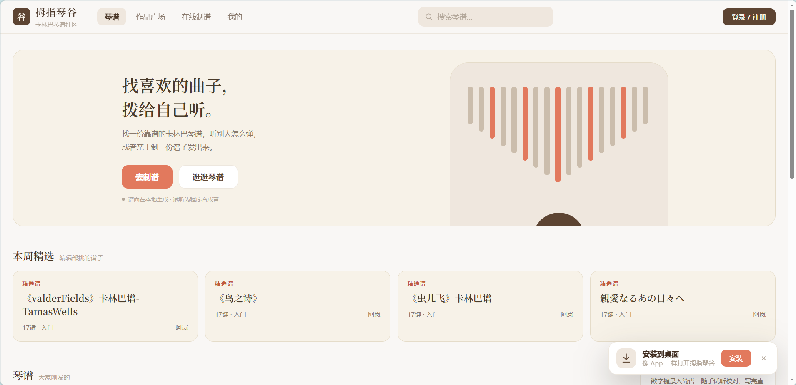
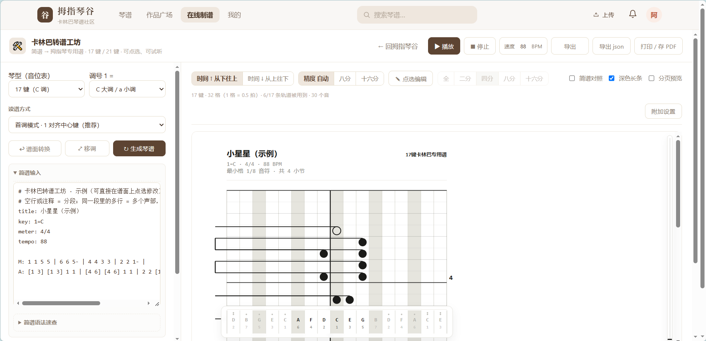
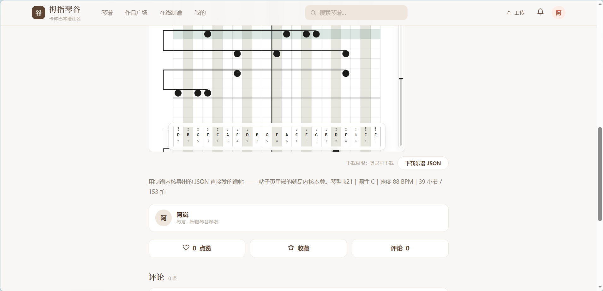
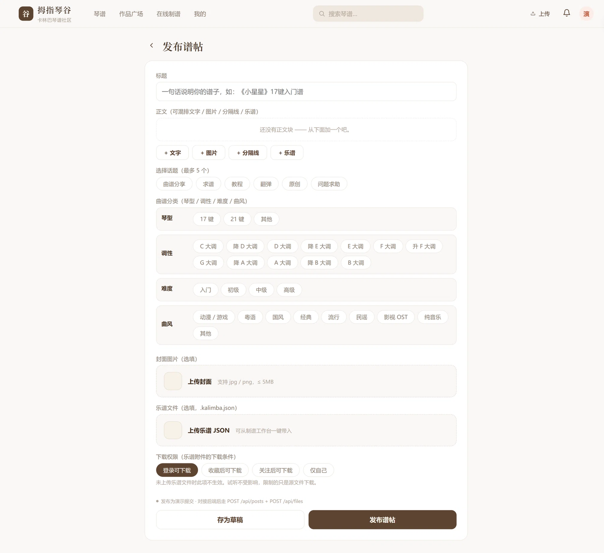
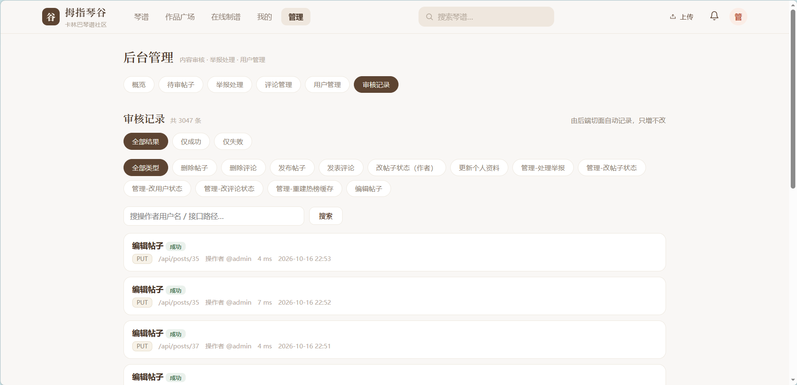
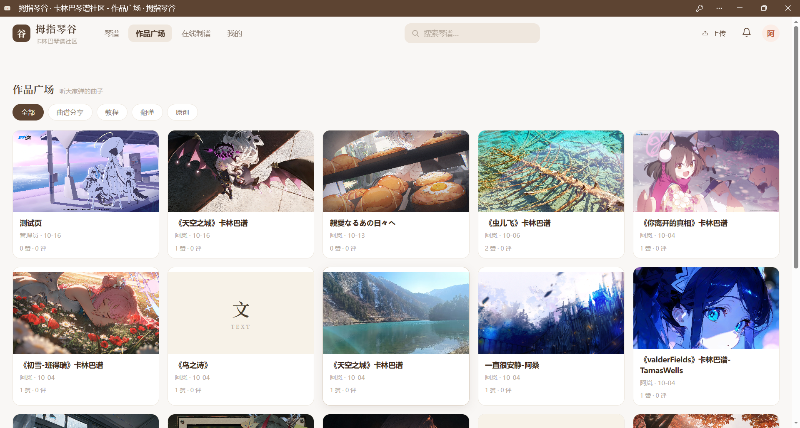

# 拇指琴谷 · 卡林巴琴谱社区（前端）

> 卡林巴（拇指琴）爱好者的乐谱社区前端：**找谱、制谱、试听、分享**。
> Vue 3 + Vite + Pinia + vue-router + Element Plus，含 PWA 安装与离线降级。

- **在线制谱**：内嵌单文件制谱器（iframe），内核零依赖、纯前端运行，谱面数据不上传
- **11 个页面**：首页 / 作品广场 / 在线制谱 / 登录注册 / 帖子详情 / 发布 / 个人主页 / 消息 / 搜索 / 后台管理 / 404
- **PWA**：可安装到桌面，断网时直接进入制谱器



---

## 一、三个仓库的分工

| 仓库 | 职责 | 地址 |
|---|---|---|
| **web-vue**（本仓库） | 社区前端站点：页面、路由、状态、接口层、PWA、在线制谱页承载 | 当前仓库 |
| **backend** | REST 服务端：账号、帖子、评论、互动、附件、审核、管理端 | <https://github.com/thetides45/Kalimba-WorkShop-backend> |
| **frontend** | 制谱内核构建工具链：单文件制谱器 → ES 模块 → 离线单文件 → 派生出本仓库的 `public/composer.html` | <https://github.com/thetides45/Kalimba-WorkShop-frontend> |

```
frontend  ──产出──▶  web-vue/public/composer.html（在线制谱页，派生文件）
web-vue   ──调用──▶  backend（/api/**）
```

**三者的边界很清晰**：制谱内核不在这里，在 `frontend` 仓库；本仓库只负责「把内核产物装进站点」，
以及站点本身的路由、状态与接口调用。后端只存社区数据，不参与制谱计算。

> ⚠️ `public/composer.html` 是**构建产物**，不要手改。改了会在下一次重跑产物链时被覆盖，
> 而且「源没变、产物却变了」会造成难以察觉的分叉。要改制谱页请去 `frontend` 仓库改内核。

---

## 二、页面与路由

| 路由 | 页面 | 说明 |
|---|---|---|
| `/` | 首页 | 热门作品、热搜、社区入口 |
| `/works` | 作品广场 | 全部作品，支持筛选与分页 |
| `/composer` | 在线制谱 | iframe 承载 `public/composer.html` |
| `/login` | 登录 / 注册 | — |
| `/post/:id` | 帖子详情 | 谱面预览、试听、评论、点赞收藏 |
| `/publish/:id?` | 发布 / 编辑 | 正文块编辑（文本/图片/乐谱/分隔线）、草稿 |
| `/user/:id?` | 个人主页 | 资料、作品、收藏、关注/粉丝 |
| `/notifications` | 消息通知 | 未读数、已读 |
| `/search` | 搜索 | 综合搜索（帖子/用户/标签）+ 热搜 |
| `/admin` | 后台管理 | 数据概览、用户/帖子/评论审核、举报、审计日志 |
| `/404` | 404 | 其余路径统一重定向至此 |

所有页面组件**懒加载**：既减小首屏，也避免 `store` / `api` 与 `router` 形成模块循环依赖。

### 界面速览

| 在线制谱 | 帖子详情 |
|:---:|:---:|
|  |  |
| 17 / 21 键切换 · 简谱输入 · 点选改音 · 实时试听与导出 | 内嵌谱面 · 播放试听 · 乐谱 JSON 下载（含下载分级） |

| 发布谱帖 | 后台管理 |
|:---:|:---:|
|  |  |
| 正文块（文本 / 图片 / 乐谱 / 分隔线）· 琴型调性分类 · 附件下载权限 | 待审内容 · 举报处理 · 用户管理 · 操作审计 |

---

## 三、技术栈

| 依赖 | 版本 | 用途 |
|---|---|---|
| Vue | 3.5 | 组合式 API |
| Vite | 6.0 | 开发与构建 |
| Pinia | 2.3 | 状态管理（`auth` / `ui` / `notification`） |
| vue-router | 4.5 | History 模式路由 |
| Element Plus | 2.9 | 组件库，**按需引入**（`unplugin-auto-import` + `unplugin-vue-components`） |

样式分两层：

- `src/styles/v3.css`：全站视觉（从早期静态版原样沿用，保证风格一致）
- `src/styles/element-theme.css`：把 Element Plus 拉回木质暖色口径

> Element Plus **不做全量注册**：`main.js` 里没有 `app.use(ElementPlus)`，也没引全量 CSS
> （约 400KB），用到的组件与样式由编译期插件注入（实测 CSS 降到约 88KB）。

---

## 四、目录结构

```
web-vue/
├── index.html                  应用壳：PWA 元信息 + 离线快速降级脚本
├── vite.config.js              别名、按需引入、dev/preview 代理
├── docs/screenshots/           README 用的界面截图（home / composer / post / publish / admin / pwa）
├── public/
│   ├── composer.html           ⚠️ 派生文件（由 frontend 仓库产物链生成，勿手改）
│   ├── manifest.webmanifest    PWA 清单（图标、快捷方式）
│   ├── sw.js                   Service Worker（缓存策略 + 离线降级）
│   ├── icons/                  PWA 图标（192 / 512 / maskable）
│   └── score-preview-demo.html 谱面预览的独立演示页
└── src/
    ├── main.js                 装配：Pinia、路由、样式、登录态注入 HTTP 层
    ├── App.vue
    ├── api/
    │   ├── http.js             fetch 封装：sa-token 头、统一响应体、2001 静默续期
    │   ├── index.js            Real 接口实现 + 按方法合并 MockAPI
    │   └── mock.js             演示数据（尚未接后端的模块走这里）
    ├── router/index.js         11 条路由 + 滚动行为 + 标题
    ├── stores/                 auth / ui / notification
    ├── shared/                 简谱解析与试听、图标、搜索历史、工具函数
    ├── components/             SiteHeader、PostCard、ScorePreview、BlockRenderer…
    ├── styles/                 v3.css、element-theme.css
    └── views/                  11 个页面
```

---

## 五、快速开始

### 1. 先跑后端

本仓库的数据全部来自 `backend`，默认地址 `http://localhost:8080`。
后端的启动方式见 [backend README](https://github.com/thetides45/Kalimba-WorkShop-backend)。
种子账号密码为 `123456`。

### 2. 安装依赖

```bash
npm install
npm run dev        # http://127.0.0.1:5174
```

> **特殊环境提示**：如果 `npm install` 因 esbuild 的 postinstall 校验中断（表现为
> `spawnSync ... EBUSY`，随后 `vite build` 报 esbuild 二进制 `could not be found`），
> 改用 `npm install --ignore-scripts`。本项目已在 `optionalDependencies` 里显式声明
> `@esbuild/win32-x64` 平台包以配合该开关。绝大多数机器直接 `npm install` 即可。

### 3. 端口与代理

| 命令 | 地址 | 说明 |
|---|---|---|
| `npm run dev` | `http://127.0.0.1:5174` | 开发服务器 |
| `npm run preview` | `http://127.0.0.1:5175` | 预览构建产物 |
| `npm run build` | `dist/` | 生产构建 |

开发时两个路径走 **Vite 代理**到 `8080`：

- `/api` → 后端接口。代理会**主动删掉 `Origin` 和 `Referer` 头**：后端 CORS 白名单按来源逐条配置，
  5174 不在名单里会被判 `Invalid CORS request`（403）；而按 Fetch 规范，POST/PUT/DELETE
  **即使同源也会带 `Origin`**，所以只有写接口会踩到，典型表现是 `/api/auth/refresh` 403。
- `/uploads` → 帖子封面与头像。封面是后端静态资源的**绝对路径**（`/uploads/img/xxx.png`），
  浏览器会按当前 origin（5174）去取，不代理就是整片破图。

`host` 固定为 `127.0.0.1`：默认的 `localhost` 在 Windows 上可能解析成 `::1`（仅监听 IPv6），
会导致访问地址与预期不一致，HMR 的 WebSocket 也容易连不上。

---

## 六、与后端的接口约定

```json
{ "code": 0, "message": "ok", "data": {} }
```

- 业务错误**一律 HTTP 200**，成败只看 `body.code`（`!== 0` 即失败）
- 令牌放在**自定义请求头 `sa-token`**，不是 `Authorization: Bearer`，也不是 Cookie
- `code === 2001` → 先静默续期一次再重放；续期本身失败才清会话跳登录（同一个请求只重试一次）
- `multipart` 上传时不设 `Content-Type`，交给浏览器生成 boundary
- 附件接口 `GET /api/files/{id}` **不套** `R{code,message,data}` 包裹，走 `rawFetch`

接口实现分两层：`api/http.js` 只负责传输与鉴权，`api/index.js` 的 `Real` 对象按模块描述接口，
最后**逐方法**合并到 `MockAPI` 之上——尚未对接后端的方法（如 `works` / `offline` 模块）
继续使用 `mock.js` 的演示数据，页面不会因为缺接口而白屏。

### 部署时的接口地址

构建产物默认直连 `http://localhost:8080`。线上两种覆盖方式：

1. 页面注入：`<script>window.API_BASE='https://api.example.com'</script>`
2. 同源反向代理：把 `/api` 与 `/uploads/img` 一起转发到后端（推荐，免 CORS）

---

## 七、PWA

- `public/manifest.webmanifest`：应用名、主题色、图标、快捷方式（在线制谱 / 搜索）
- `public/sw.js`：Service Worker，缓存策略分档
  - 页面导航 → network-first，断网回落缓存，最后兜底应用壳
  - 构建产物 `/assets/**` → cache-first（文件名带内容哈希）
  - 壳 / 图标 / 制谱器 → 预缓存
  - 其余同源 GET（含 dev 的 `/src/**`）→ **完全不接管**，避免「壳新模块旧」
  - `/api/**` 与跨域请求 → 一律不拦
- **离线降级**：从桌面图标启动且确实离线时，直接进入制谱器（制谱器本身是自包含单文件，离线完全可用）



以独立窗口运行（无浏览器地址栏），这是「已安装到桌面」的状态，不是浏览器标签页。

> ⚠️ **只要 `PRECACHE` 里的内容变了就必须升 `VERSION`**，否则 `activate` 不清旧缓存，
> 装过 PWA 的浏览器会一直拿到旧副本。
> Service Worker 只在 **HTTPS 或 localhost** 下生效，`file://` 打开不会注册，这是浏览器规则。

---

## 八、已知边界

- **缺少单元测试**：目前靠 `backend/tools/` 的端到端冒烟脚本（含 `web_vue_smoke.js`、`pwa_smoke.js`）覆盖页面交互。
- **部分模块仍是演示数据**：`api/mock.js` 覆盖尚未接入后端的方法，接入后按模块替换。
- **制谱页不可直接修改**：必须走 `frontend` 仓库的产物链重新生成。

---

## 九、相关链接

- 后端服务：<https://github.com/thetides45/Kalimba-WorkShop-backend>
- 制谱内核构建链：<https://github.com/thetides45/Kalimba-WorkShop-frontend>
